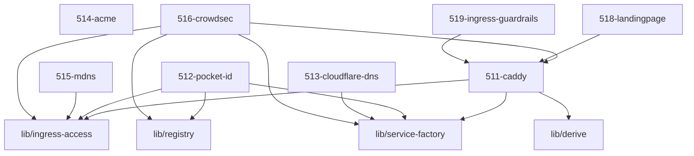

# LLM Wiki: `51-ingress`

Agentenorientierte Arbeitskarte. Menschliche Architektur-/Betriebsdoku: [`README.md`](README.md).

Alles **unterhalb der AUTO-GENERATED-Markierung** stammt aus den NIXMETA-Headern
(`python3 50-core/medinix-meta.py generate-docs`) — **nie** von Hand ändern, sonst
wird `check-docs` rot. Dieser manuelle Teil bleibt erhalten (der Marker-String
darf im Text nicht wörtlich vorkommen, sonst schneidet der Generator dort ab).

**Rolle:** Edge-/Ingress-Domäne — die Zugangsschicht in die Dienste.

**Verantwortung:**
- HTTP(S)-Ingress und Caddy (511)
- Auth-/OIDC-Integration (512)
- DNS/DDNS (513)
- ACME/TLS (514)
- mDNS (515)
- CrowdSec-Bouncer (516)
- Landingpage (518)
- Ingress-Guardrails und Ownership-Konflikte (519)

**Nicht verantwortlich für:**
- Host-Firewall und Host-Security → `52-security`
- Service-Definitionen → jeweiliges Service-Modul
- Media-Daten/Storage → entsprechende Domäne

**Source of truth:**
- Service-/Vhost-Intent → `ingress.vhosts`
- Runtime-Identitäten → `lib/registry.nix`
- Modulbeziehungen → NIXMETA-Header
- Caddy-Implementierung → `511-caddy.nix`

**Arbeitsregel:**
- Änderungen an Ingress zuerst gegen den bestehenden Contract prüfen.
- Keine zweite Service-/Route-Inventarliste erzeugen.
- Keine Ownership implizit übernehmen.

## Was hier leicht schiefgeht (hart erarbeitet)

- **`accessGroup` hat EINEN Produzenten.** Die Auflösung lebt in
  `lib/ingress-access.nix` (`accessGroupOf cfg n m`: Vhost-Override gewinnt,
  sonst das Manifest) und wird von `511` (Rendering), `513` (DNS), `515` (mDNS)
  und `518` (Tiles) importiert — nicht in 511 selbst. Nie beide Stellen
  pflegen; die Divergenz war ein stiller Auth-Bypass (F1/F2,
  `docs/ingress-security-matrix.md`).
- **`allowUnauthenticated` löst genauso auf** (`nullOr bool`, Vhost gewinnt).
  `null` = Manifest entscheidet, ein explizites `false` **widerruft** eine
  Manifest-Ack. Vorher war es ein ODER — eine geerbte Ack öffnete still
  (Review 2026-10-17, Finding 1).
- **Pocket-ID (512) kann kein forward-auth.** Sie ist OIDC-IdP **ohne**
  forward-auth-Endpoint. `auth.mode = "forward-auth"` verlangt zusätzlich
  `authProxyPresent = true` + `ingress.auth.forwardAuthUpstream`
  (oauth2-proxy, ADR-517) — sonst bricht `511` per Assertion ab.
- **`localBypass` existiert nicht mehr.** Er war nie verdrahtet (0 Leser).
  `.lan` ist **nur** CIDR-gegated (`lanAbort`); WAN-`public` erzwingt `forward_auth`.
- **`.lan` ≠ `.local`.** `.lan` ist der Caddy-Vhost, `.local` ist mDNS (515).
- **TLS kommt nicht von Caddy.** `514-acme.nix` holt das Wildcard über
  NixOS-ACME/Lego (Cloudflare DNS-01); Caddy läuft `auto_https off` und liest
  `/var/lib/acme/{acmeHost}/{fullchain,key}.pem`.
- **Caddy-Admin-API nur über Unix-Socket** im RuntimeDirectory (RT-1) — **nicht**
  `127.0.0.1:2019`.
- **Header-Strip-Reihenfolge:** `request_header` **vor** `forward_auth`
  (`checks.mediNix-ingress-header-strip`).
- **`trustedCidrs` muss explizit gesetzt sein** — leer + aktive vhosts = Build-Fehler.

## Prüfen (lokal; auf diesem Gerät gibt es kein `nix`)

```bash
nixfmt --check 51-ingress/*.nix
python3 scripts/check_manifest_edge.py      # Kante Code -> Manifest
python3 scripts/nixos_idiom_audit.py --p0-only
python3 scripts/check_sources.py            # Upstream-Quellen je Manifest-Traeger
python3 scripts/check_adrs.py               # ADR-Form + Kante Code -> ADR
```

Die Ingress-Checks laufen erst in CI (`Flake Check`), u. a.
`mediNix-caddy-single-owner`, `mediNix-ingress-header-strip`,
`mediNix-negative-vhost-unresolved`, `mediNix-negative-forward-auth-upstream`.


<!-- AUTO-GENERATED, DO NOT EDIT BELOW -->

> ⚙️ **Maschinell erzeugt** aus den NIXMETA-Headern der Module (`python3 50-core/medinix-meta.py generate-docs`).
> **Nicht von Hand aendern** — handgepflegt ist nur der Teil **ueber** der Markierung; die Wahrheit steht in den unten verlinkten `.nix`-Dateien (`docs/CONVENTIONS.md` §1).

## Module Map

| ID | Modul-Datei | Status | Komplexitaet | Ports |
|---|---|---|---|---|
| `511-caddy` | [`511-caddy.nix`](511-caddy.nix) | active | -/5 | - |
| `512-pocket-id` | [`512-pocket-id.nix`](512-pocket-id.nix) | active | 4/5 |  |
| `513-cloudflare-dns` | [`513-cloudflare-dns.nix`](513-cloudflare-dns.nix) | active | -/5 | - |
| `514-acme` | [`514-acme.nix`](514-acme.nix) | active | -/5 | - |
| `515-mdns` | [`515-mdns.nix`](515-mdns.nix) | active | 3/5 | - |
| `516-crowdsec` | [`516-crowdsec.nix`](516-crowdsec.nix) | active | 3/5 | - |
| `518-landingpage` | [`518-landingpage.nix`](518-landingpage.nix) | active | 2/5 | - |
| `519-ingress-guardrails` | [`519-ingress-guardrails.nix`](519-ingress-guardrails.nix) | active | 2/5 | - |

## Interne Abhaengigkeiten (Requires)

Die Module in diesem Ordner benoetigen folgende Bibliotheken/Dateien:

- [`51-ingress/511-caddy`](../51-ingress/511-caddy.nix)
- [`511-caddy`](511-caddy.nix)
- [`lib/derive`](../lib/derive.nix)
- [`lib/ingress-access`](../lib/ingress-access.nix)
- [`lib/registry`](../lib/registry.nix)
- [`lib/service-factory`](../lib/service-factory.nix)

## Dependency Graph




---
*Maschinell erzeugt durch `python3 50-core/medinix-meta.py generate-docs` aus den NIXMETA-Headern der oben verlinkten `.nix`-Dateien. Handgepflegt ist nur der Teil ueber der AUTO-GENERATED-Markierung.*
