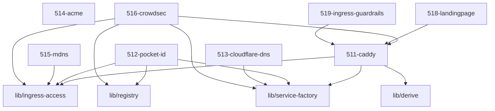

# LLM Wiki: `51-ingress`

Agentenorientierte Arbeitskarte. Menschliche Architektur-/Betriebsdoku: [`README.md`](README.md).

Alles **unterhalb der AUTO-GENERATED-Markierung** stammt aus den NIXMETA-Headern
(`python3 50-core/medinix-meta.py generate-docs`) — **nie** von Hand ändern, sonst
wird `check-docs` rot. Dieser manuelle Teil bleibt erhalten (der Marker-String
darf im Text nicht wörtlich vorkommen, sonst schneidet der Generator dort ab).

**Rolle:** Edge-/Ingress-Domäne — die Zugangsschicht in die Dienste.

**Verantwortung:**
- HTTP(S)-Ingress und Caddy (511)
- Auth-/OIDC-Integration (512)
- DNS/DDNS (513)
- ACME/TLS (514)
- mDNS (515)
- CrowdSec-Bouncer (516)
- Landingpage (518)
- Ingress-Guardrails und Ownership-Konflikte (519)
- 517 oauth2-proxy: **ADR-517 ist entschieden, das Modul fehlt noch** — Slot 5170 ist reserviert

**Nicht verantwortlich für:**
- Host-Firewall und Host-Security → `52-security`
- Service-Definitionen → jeweiliges Service-Modul
- Media-Daten/Storage → entsprechende Domäne

**Source of truth:**
- Service-/Vhost-Intent → `ingress.vhosts`
- Effektive Zugriffsgruppe + Caddy-Modus → `lib/ingress-access.nix`
  (`accessGroupOf`, `isWan` = `public|stream|idp`, `caddyUnitOf`)
- Runtime-Identitäten → `lib/registry.nix`
- Modulbeziehungen → NIXMETA-Header
- Caddy-Implementierung → `511-caddy.nix`
- Domain: `medinix.domain` ist ein **Alias** von `medinix.host.domain`
  (`50-core/502-host-settings.nix:23`) — eine Quelle, drei Schreibweisen

**Arbeitsregel:**
- Änderungen an Ingress zuerst gegen den bestehenden Contract prüfen.
- Keine zweite Service-/Route-Inventarliste erzeugen.
- Keine Ownership implizit übernehmen.

## Was hier leicht schiefgeht (hart erarbeitet)

- **`accessGroup` hat EINEN Produzenten.** Die Auflösung lebt in
  `lib/ingress-access.nix` (`accessGroupOf cfg n m`: Vhost-Override gewinnt,
  sonst das Manifest) und wird von `511` (Rendering), `513` (DNS), `515` (mDNS)
  und `518` (Tiles) importiert — nicht in 511 selbst. Nie beide Stellen
  pflegen; die Divergenz war ein stiller Auth-Bypass (F1/F2,
  `docs/ingress-security-matrix.md`).
- **`allowUnauthenticated` löst genauso auf** (`nullOr bool`, Vhost gewinnt).
  `null` = Manifest entscheidet, ein explizites `false` **widerruft** eine
  Manifest-Ack. Vorher war es ein ODER — eine geerbte Ack öffnete still
  (Review 2026-10-17, Finding 1).
- **Pocket-ID (512) kann kein forward-auth.** Sie ist OIDC-IdP **ohne**
  forward-auth-Endpoint. `auth.mode = "forward-auth"` verlangt zusätzlich
  `authProxyPresent = true` + `ingress.auth.forwardAuthUpstream`
  (oauth2-proxy, ADR-517) — sonst bricht `511` per Assertion ab. Das Modul
  `517-oauth2-proxy.nix` und `medinix.oauth2Proxy` gibt es noch nicht.
- **`localBypass` existiert nicht mehr.** Er war nie verdrahtet (0 Leser).
  `.lan` ist **nur** CIDR-gegated (`lanAbort`); WAN-`public` erzwingt `forward_auth`.
- **`.lan` ≠ `.local`.** `.lan` ist der Caddy-Vhost, `.local` ist mDNS (515) —
  `511` rendert für `.local` **keine** Site.
- **`internal` ist mehr als `.lan`:** seit 2026-10-17 rendert `511` zusätzlich
  `{name}.{domain}` mit TLS + `lanAbort` (nur mit `tlsEnabled`) — ohne das ist der
  Passkey-Bootstrap von 512 nicht möglich (Review Finding 14).
- **TLS kommt nicht von Caddy.** `514-acme.nix` holt das Wildcard über
  NixOS-ACME/Lego (Cloudflare DNS-01); Caddy läuft `auto_https off` und liest
  `/var/lib/acme/{acmeHost}/{fullchain,key}.pem`.
- **Caddy-Admin-API nur über Unix-Socket** im RuntimeDirectory (RT-1):
  `admin unix//run/{caddy,caddy-media}/admin.sock` (`511:143-144`) —
  **nicht** `127.0.0.1:2019`.
- **Reihenfolge im `route { }`:** `${stripAuthHeaders}` → `${authBlock}`
  (`forward_auth`) → `${customConfig}` (`511:212-216`). Strip **vor**
  `forward_auth`, sonst sind Client-Header spoofbar
  (`checks.mediNix-ingress-header-strip`).
- **Der Strip gilt für JEDE Route** — er sitzt in `mkServiceBlock`, nicht im
  `authBlock`; sonst sind `.lan`, `stream`, `idp` und `allowUnauthenticated`
  spoofbar. Die Liste muss ein Superset der `copy_headers` sein
  (`checks.mediNix-ingress-header-strip-superset`).
- **`trustedCidrs` muss explizit gesetzt sein** — leer + aktive vhosts = Build-Fehler.
- **516 liest die Caddy-Unit über `ia.caddyUnitOf`** (`caddy.service` bei
  `global`, `caddy-media.service` bei `standalone`) — nie hartkodieren
  (Review Finding 13).
- **`idp` und `stream` sind WAN-offen ohne Ingress-Auth.** `idp` ist per
  Assertion dem IdP selbst vorbehalten; `stream` darf nur, wer es im Manifest
  deklariert — jede Abweichung braucht `medinix.ingress.streamAck = [ … ]`
  (Review Finding 20). `accessGroup` also nicht per Vhost „mal eben" umlegen.

## Prüfen

`AGENTS.md` ist **generiert**: nur der Teil über der Markierung ist handgepflegt.
`check-docs` läuft in **keiner** CI — eine veraltete Karte fällt dort nicht auf:

```bash
python3 50-core/medinix-meta.py generate-docs   # nach NIXMETA-Header-Aenderungen
python3 50-core/medinix-meta.py check-docs      # Gegenprobe
```

Mit `nix`: die CI nutzt die **flake-gepinnten** Tools, nicht die PATH-Versionen
(`PATH`-`nixfmt` kann neuer sein und anders umbrechen als der CI-Formatter):

```bash
FN=$(nix build --no-link --print-out-paths .#formatter.x86_64-linux)
$FN/bin/nixfmt --check 51-ingress/*.nix
nix build --no-link .#checks.x86_64-linux.mediNix-ingress-header-strip-superset  # ein einzelner Check
nix flake check                        # alles: 47 Checks inkl. VM-Smoke-Test (dauert)
```

Ohne `nix` bleibt nur die Python-Ebene:

```bash
python3 scripts/check_manifest_edge.py       # Kante Code -> Manifest
python3 scripts/check_sources.py             # Upstream-Quellen je Manifest-Traeger
python3 scripts/check_adrs.py                # ADR-Form + Kante Code -> ADR
python3 scripts/check_banned_technologies.py # verbotene Technologien + IdP-Whitelist
python3 scripts/nixos_idiom_audit.py --p0-only
```

Einzeln baubare Ingress-Checks (Rest siehe `nix flake check`):
`mediNix-caddy-single-owner`, `mediNix-ingress-header-strip`,
`mediNix-ingress-accessgroup-consistency`, `mediNix-landing-tiles`,
`mediNix-ddns-prune-fqdn`, `mediNix-ntfy-vhost-and-admin-socket`,
`mediNix-acme-positive`, `mediNix-negative-vhost-unresolved`,
`mediNix-negative-forward-auth-upstream`, `mediNix-negative-forward-auth-upstream-scheme`,
`mediNix-negative-ack-override-revokes`, `mediNix-negative-pocket-id-setup-vhost-override`,
`mediNix-negative-cidr-prefix-too-wide`, `mediNix-negative-cidr-injection`,
`mediNix-negative-crowdsec-bouncer`, `mediNix-negative-acme-domain`,
`mediNix-negative-landing-cidrs`.


<!-- AUTO-GENERATED, DO NOT EDIT BELOW -->

> ⚙️ **Maschinell erzeugt** aus den NIXMETA-Headern der Module (`python3 50-core/medinix-meta.py generate-docs`).
> **Nicht von Hand aendern** — handgepflegt ist nur der Teil **ueber** der Markierung; die Wahrheit steht in den unten verlinkten `.nix`-Dateien (`docs/CONVENTIONS.md` §1).

## Module Map

| ID | Modul-Datei | Status | Komplexitaet | Ports |
|---|---|---|---|---|
| `511-caddy` | [`511-caddy.nix`](511-caddy.nix) | active | -/5 | - |
| `512-pocket-id` | [`512-pocket-id.nix`](512-pocket-id.nix) | active | 4/5 |  |
| `513-cloudflare-dns` | [`513-cloudflare-dns.nix`](513-cloudflare-dns.nix) | active | -/5 | - |
| `514-acme` | [`514-acme.nix`](514-acme.nix) | active | -/5 | - |
| `515-mdns` | [`515-mdns.nix`](515-mdns.nix) | active | 3/5 | - |
| `516-crowdsec` | [`516-crowdsec.nix`](516-crowdsec.nix) | active | 3/5 | - |
| `518-landingpage` | [`518-landingpage.nix`](518-landingpage.nix) | active | 2/5 | - |
| `519-ingress-guardrails` | [`519-ingress-guardrails.nix`](519-ingress-guardrails.nix) | active | 2/5 | - |

## Interne Abhaengigkeiten (Requires)

Die Module in diesem Ordner benoetigen folgende Bibliotheken/Dateien:

- [`51-ingress/511-caddy`](../51-ingress/511-caddy.nix)
- [`511-caddy`](511-caddy.nix)
- [`lib/derive`](../lib/derive.nix)
- [`lib/ingress-access`](../lib/ingress-access.nix)
- [`lib/registry`](../lib/registry.nix)
- [`lib/service-factory`](../lib/service-factory.nix)

## Dependency Graph




---
*Maschinell erzeugt durch `python3 50-core/medinix-meta.py generate-docs` aus den NIXMETA-Headern der oben verlinkten `.nix`-Dateien. Handgepflegt ist nur der Teil ueber der AUTO-GENERATED-Markierung.*
