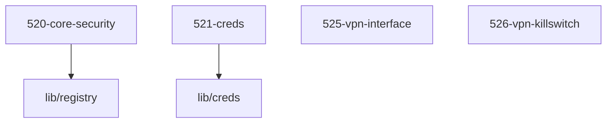

# LLM Wiki: `52-security`

> **Zweck:** Fundamentale Host-Sicherheit: sealed systemd-Credentials (521), Break-glass-User `media-admin` (520), `medinix.recommended.*`-Vorschläge und optional LUKS+TPM2 (520), WireGuard-Interface mit encrypted Private Key (525) sowie fail-closed VPN-Confinement per skuid-Policy-Routing (526). Additive Host-Integration — schreibt nichts bei `hostIntegration.* = external|off`.

<!-- AUTO-GENERATED, DO NOT EDIT BELOW -->

> ⚙️ **Maschinell erzeugt** aus den NIXMETA-Headern der Module (`python3 50-core/medinix-meta.py generate-docs`).
> **Nicht von Hand aendern** — handgepflegt ist nur der Teil **ueber** der Markierung; die Wahrheit steht in den unten verlinkten `.nix`-Dateien (`docs/CONVENTIONS.md` §1).

## Module Map

| ID | Modul-Datei | Status | Komplexitaet | Ports |
|---|---|---|---|---|
| `520-core-security` | [`520-core-security.nix`](520-core-security.nix) | active | 3/5 | - |
| `521-creds` | [`521-creds.nix`](521-creds.nix) | active | 3/5 | - |
| `525-vpn-interface` | [`525-vpn-interface.nix`](525-vpn-interface.nix) | active | 4/5 | - |
| `526-vpn-killswitch` | [`526-vpn-killswitch.nix`](526-vpn-killswitch.nix) | active | 5/5 | - |

## Interne Abhaengigkeiten (Requires)

Die Module in diesem Ordner benoetigen folgende Bibliotheken/Dateien:

- [`lib/creds`](../lib/creds.nix)
- [`lib/registry`](../lib/registry.nix)

## Dependency Graph

---
*Maschinell erzeugt durch `python3 50-core/medinix-meta.py generate-docs` aus den NIXMETA-Headern der oben verlinkten `.nix`-Dateien. Handgepflegt ist nur der Teil ueber der AUTO-GENERATED-Markierung.*
