# LLM Wiki: `53-acquisition`

> **Zweck:** Beschaffung — Indexer-Anbindung und die *arr-Suite (Suche, Überwachung, Download-Auftrag).

Alles **unterhalb der AUTO-GENERATED-Markierung** stammt aus den NIXMETA-Headern
(`python3 scripts/medinix-meta.py generate-docs`) — **nie** von Hand ändern, sonst
wird `check-docs` rot. Dieser manuelle Teil bleibt erhalten (den Marker-String
nicht wörtlich im Text nennen, sonst schneidet der Generator dort ab).

**Rolle:** Beschaffungsdomäne (Service-Nummern 53x).

**Verantwortung:**
- `532` Sonarr (TV), `533` Radarr (Filme), `534` Readarr (Bücher), `535` Lidarr (Musik)
- `536` Prowlarr — Indexer-Hub für alle *arr
- Download-Kategorien (`tv`/`movies`/`books`/`music`) als Vertrag mit dem Downloader

**Nicht verantwortlich für:**
- Download selbst → `54-processing` (541 SABnzbd)
- Playback/Medienserver → `55-playback`
- WAN-Zugang und Auth → `51-ingress`; die Registry führt diese Dienste als `internal`

**Source of truth:**
- Port/UID/Dienstnummer → `50-core/registry.nix` (Dezimalrahmen, ADR-0000)
- Kategorie je Dienst → `50-core/service-contract.nix` (`arr.category`), provisioniert in `53-acquisition/538-provisioning.nix`
- WAN-Freigabe heißt `ingress.vhosts.<name>.accessGroup = "public"` setzen — nicht das Modul ändern

**Bekannte Klemmen:**
- ADR-517 nennt Sonarr/Radarr/Readarr/Lidarr/Prowlarr als Kandidaten für `forward_auth`. Über das Modul allein passiert das **nicht**: die Registry-Rolle ist `internal`, und 511 rendert `forward_auth` nur für `accessGroup = "public"` (WAN). Wer sie hinter den Auth-Proxy stellen will, muss aktiv auf `public` stellen.

<!-- AUTO-GENERATED, DO NOT EDIT BELOW -->

> ⚙️ **Maschinell erzeugt** aus den NIXMETA-Headern der Module (`python3 scripts/medinix-meta.py generate-docs`).
> **Nicht von Hand aendern** — handgepflegt ist nur der Teil **ueber** der Markierung; die Wahrheit steht in den unten verlinkten `.nix`-Dateien (`docs/CONVENTIONS.md` §1).

## Module Map

| ID | Modul-Datei | Status | Komplexitaet | Ports |
|---|---|---|---|---|
| `532-sonarr` | [`532-sonarr.nix`](532-sonarr.nix) | active | 3/5 | - |
| `533-radarr` | [`533-radarr.nix`](533-radarr.nix) | active | 3/5 | - |
| `534-readarr` | [`534-readarr.nix`](534-readarr.nix) | active | 3/5 | - |
| `535-lidarr` | [`535-lidarr.nix`](535-lidarr.nix) | active | 3/5 | - |
| `536-prowlarr` | [`536-prowlarr.nix`](536-prowlarr.nix) | active | 3/5 | - |
| `537-recyclarr` | [`537-recyclarr.nix`](537-recyclarr.nix) | active | 3/5 | - |
| `538-provisioning` | [`538-provisioning.nix`](538-provisioning.nix) | active | 3/5 | - |
| `arr-key-sync` | [`arr-key-sync.nix`](arr-key-sync.nix) | active | 2/5 | - |
| `arr-settings` | [`arr-settings.nix`](arr-settings.nix) | active | 2/5 | - |

## Interne Abhaengigkeiten (Requires)

Die Module in diesem Ordner benoetigen folgende Bibliotheken/Dateien:

- [`50-core/hardening-profiles`](../50-core/hardening-profiles.nix)
- [`50-core/memory-policy`](../50-core/memory-policy.nix)
- [`50-core/registry`](../50-core/registry.nix)
- [`50-core/service-factory`](../50-core/service-factory.nix)
- [`51-ingress/ingress-access`](../51-ingress/ingress-access.nix)
- [`53-acquisition/arr-settings`](../53-acquisition/arr-settings.nix)

## Dependency Graph

```mermaid
graph TD
  532_sonarr["532-sonarr"] --> arr_settings["53-acquisition/arr-settings"]
  532_sonarr["532-sonarr"] --> ingress_access["51-ingress/ingress-access"]
  532_sonarr["532-sonarr"] --> service_factory["50-core/service-factory"]
  532_sonarr["532-sonarr"] --> registry["50-core/registry"]
  532_sonarr["532-sonarr"] --> hardening_profiles["50-core/hardening-profiles"]
  532_sonarr["532-sonarr"] --> memory_policy["50-core/memory-policy"]
  533_radarr["533-radarr"] --> arr_settings["53-acquisition/arr-settings"]
  533_radarr["533-radarr"] --> ingress_access["51-ingress/ingress-access"]
  533_radarr["533-radarr"] --> service_factory["50-core/service-factory"]
  533_radarr["533-radarr"] --> registry["50-core/registry"]
  533_radarr["533-radarr"] --> hardening_profiles["50-core/hardening-profiles"]
  533_radarr["533-radarr"] --> memory_policy["50-core/memory-policy"]
  534_readarr["534-readarr"] --> arr_settings["53-acquisition/arr-settings"]
  534_readarr["534-readarr"] --> service_factory["50-core/service-factory"]
  534_readarr["534-readarr"] --> registry["50-core/registry"]
  534_readarr["534-readarr"] --> hardening_profiles["50-core/hardening-profiles"]
  534_readarr["534-readarr"] --> memory_policy["50-core/memory-policy"]
  535_lidarr["535-lidarr"] --> arr_settings["53-acquisition/arr-settings"]
  535_lidarr["535-lidarr"] --> service_factory["50-core/service-factory"]
  535_lidarr["535-lidarr"] --> registry["50-core/registry"]
  535_lidarr["535-lidarr"] --> hardening_profiles["50-core/hardening-profiles"]
  535_lidarr["535-lidarr"] --> memory_policy["50-core/memory-policy"]
  536_prowlarr["536-prowlarr"] --> arr_settings["53-acquisition/arr-settings"]
  536_prowlarr["536-prowlarr"] --> ingress_access["51-ingress/ingress-access"]
  536_prowlarr["536-prowlarr"] --> service_factory["50-core/service-factory"]
  536_prowlarr["536-prowlarr"] --> registry["50-core/registry"]
  536_prowlarr["536-prowlarr"] --> hardening_profiles["50-core/hardening-profiles"]
  536_prowlarr["536-prowlarr"] --> memory_policy["50-core/memory-policy"]
  537_recyclarr["537-recyclarr"] --> registry["50-core/registry"]
  538_provisioning["538-provisioning"]
  arr_key_sync["arr-key-sync"]
  arr_settings["arr-settings"]
```

---
*Maschinell erzeugt durch `python3 scripts/medinix-meta.py generate-docs` aus den NIXMETA-Headern der oben verlinkten `.nix`-Dateien. Handgepflegt ist nur der Teil ueber der AUTO-GENERATED-Markierung.*
