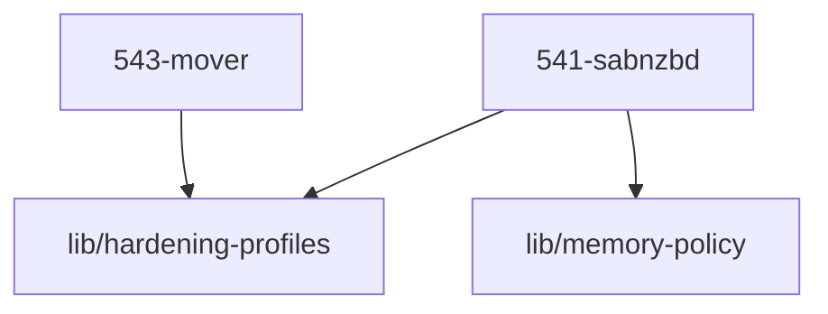

# LLM Wiki: `54-transfer`

> **Zweck:** Transport — Usenet-Download und das Verschieben von Medien zwischen Speicher-Tiers.

Alles **unterhalb der AUTO-GENERATED-Markierung** stammt aus den NIXMETA-Headern
(`python3 50-core/medinix-meta.py generate-docs`) — **nie** von Hand ändern, sonst
wird `check-docs` rot. Dieser manuelle Teil bleibt erhalten (den Marker-String
nicht wörtlich im Text nennen, sonst schneidet der Generator dort ab).

**Rolle:** Transfer-/Logistikdomäne (54x).

**Verantwortung:**
- `541` SABnzbd — Usenet-Downloader (`internal`, mit `RestrictNetworkInterfaces`)
- Ondemand-Mover — schiebt Medien von Tier B (SSD) nach Tier C (HDD), wenn der SSD-Platz knapp wird

**Nicht verantwortlich für:**
- Beschaffung/Job-Erzeugung → `53-acquisition` (die *arr setzen die Aufträge ab)
- Zielstruktur der Verzeichnisse/MergerFS → `57-maintenance`
- Backup → `57-maintenance` (Restic)

**Source of truth:**
- Port/UID → `lib/registry.nix`
- Kategoriename je Auftrag → `lib/service-contract.nix` (`arr.category`), Provisioning in `57-maintenance/574-provisioning.nix`
- Tiering-Pfade und Schwellen → das Mover-Modul selbst

**Bekannte Klemmen:**
- ADR-0003 §3: fehlt ein Mountpoint, muss der Mover *fail-closed* abbrechen — nicht stillschweigend aufs falsche Ziel schreiben.

<!-- AUTO-GENERATED, DO NOT EDIT BELOW -->

> ⚙️ **Maschinell erzeugt** aus den NIXMETA-Headern der Module (`python3 50-core/medinix-meta.py generate-docs`).
> **Nicht von Hand aendern** — handgepflegt ist nur der Teil **ueber** der Markierung; die Wahrheit steht in den unten verlinkten `.nix`-Dateien (`docs/CONVENTIONS.md` §1).

## Module Map

| ID | Modul-Datei | Status | Komplexitaet | Ports |
|---|---|---|---|---|
| `541-sabnzbd` | [`541-sabnzbd.nix`](541-sabnzbd.nix) | active | -/5 | - |
| `543-mover` | [`543-mover.nix`](543-mover.nix) | active | 3/5 | - |

## Interne Abhaengigkeiten (Requires)

Die Module in diesem Ordner benoetigen folgende Bibliotheken/Dateien:

- [`lib/hardening-profiles`](../lib/hardening-profiles.nix)
- [`lib/memory-policy`](../lib/memory-policy.nix)

## Dependency Graph

---
*Maschinell erzeugt durch `python3 50-core/medinix-meta.py generate-docs` aus den NIXMETA-Headern der oben verlinkten `.nix`-Dateien. Handgepflegt ist nur der Teil ueber der AUTO-GENERATED-Markierung.*
