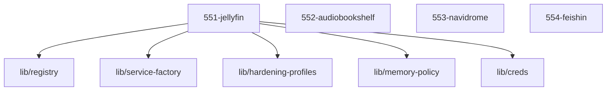

# LLM Wiki: `55-playback`

> **Zweck:** [BITTE MANUELL AUSFUELLEN: Wofuer ist dieser Ordner zustaendig?]

<!-- AUTO-GENERATED, DO NOT EDIT BELOW -->

> ⚙️ **Maschinell erzeugt** aus den NIXMETA-Headern der Module (`python3 50-core/medinix-meta.py generate-docs`).
> **Nicht von Hand aendern** — handgepflegt ist nur der Teil **ueber** der Markierung; die Wahrheit steht in den unten verlinkten `.nix`-Dateien (`docs/CONVENTIONS.md` §1).

## Module Map

| ID | Modul-Datei | Status | Komplexitaet | Ports |
|---|---|---|---|---|
| `551-jellyfin` | [`551-jellyfin.nix`](551-jellyfin.nix) | active | 3/5 |  |
| `552-audiobookshelf` | [`552-audiobookshelf.nix`](552-audiobookshelf.nix) | active | -/5 | - |
| `553-navidrome` | [`553-navidrome.nix`](553-navidrome.nix) | active | -/5 | - |
| `554-feishin` | [`554-feishin.nix`](554-feishin.nix) | active | -/5 | - |

## Interne Abhaengigkeiten (Requires)

Die Module in diesem Ordner benoetigen folgende Bibliotheken/Dateien:

- [`lib/creds`](../lib/creds.nix)
- [`lib/hardening-profiles`](../lib/hardening-profiles.nix)
- [`lib/memory-policy`](../lib/memory-policy.nix)
- [`lib/registry`](../lib/registry.nix)
- [`lib/service-factory`](../lib/service-factory.nix)

## Dependency Graph

---
*Maschinell erzeugt durch `python3 50-core/medinix-meta.py generate-docs` aus den NIXMETA-Headern der oben verlinkten `.nix`-Dateien. Handgepflegt ist nur der Teil ueber der AUTO-GENERATED-Markierung.*
