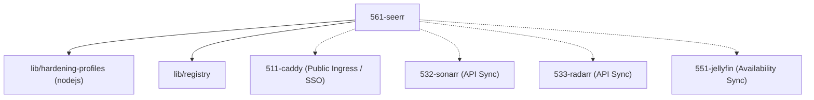

# 56-anfragen: Request Management Domain

The **Request Management Domain** (Domain 56) provides the user-facing request and discovery portal for the media stack. It serves as the interactive bridge between users, the streaming services (Domain 55 Playback), and the automated acquisition pipeline (Domain 53 Acquisition).

## 🎯 Core Responsibilities

1. **Media Discovery & Search:** Allowing authenticated users to discover movies and TV shows with rich metadata, trailers, and recommendations.
2. **Request Lifecycle Management:** Handling user requests, approval workflows, and automated forwarding to Sonarr (TV) and Radarr (Movies).
3. **Availability Tracking:** Monitoring Plex/Jellyfin libraries to notify users when requested media is ready for playback.
4. **Zero-Trust Access:** Exposing the portal securely via Caddy reverse proxy with Pocket-ID SSO forward authentication.

## 🧩 Services in the Dezimalrahmen

Each module is strictly configured according to the mediNix Dezimalrahmen convention (ADR-0000):

| ID  | Service | UID / Port | Status | Responsibility |
| :--- | :--- | :--- | :--- | :--- |
| **561** | [Seerr](561-seerr.nix)   [[ADR-5610]] | `5610` | active | **Seerr** — The central request portal (Jellyseerr/Overseerr) bridging users to Sonarr and Radarr. |

## 🔗 Dependencies & Architecture Graph

## 🛡️ Key Architecture Decisions

- **Decimal Alignment (ADR-0000):** Seerr is canonical service `561` with Port `5610` and UID `5610`.
- **SQLite WAL Mode Auto-Repair:** An idempotent `ExecStartPre` hook enforces `PRAGMA journal_mode=WAL;` on startup, preventing SQLite concurrency locks (`database locked`).
- **DynamicUser & Privilege Separation:** Runs as an unprivileged service with strict `nodejs` systemd hardening (`ProtectSystem=strict`, `ProtectHome=true`, `PrivateTmp=true`, `SystemCallErrorNumber=EPERM`).
- **tmpfiles Ordering:** Parent state directory (`/var/lib/seerr-5610`) is explicitly declared before child paths to ensure deterministic ownership.
