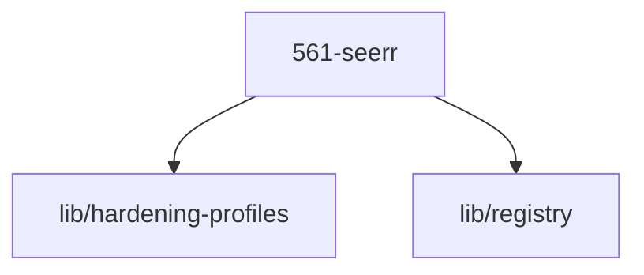

# LLM Wiki: `56-exposition`

> **Zweck:** Exposition, Request-Management & Medien-Entdeckung (Seerr / 561) nach ADR-0000.

<!-- AUTO-GENERATED, DO NOT EDIT BELOW -->

## Module Map

| ID | Modul-Datei | Status | Komplexitaet | Ports |
|---|---|---|---|---|
| `561-seerr` | `561-seerr.nix` | active | 3/5 | 5610 |

## Interne Abhaengigkeiten (Requires)

Die Module in diesem Ordner benoetigen folgende Bibliotheken/Dateien:

- `lib/hardening-profiles`
- `lib/registry`

## Dependency Graph

---
*Generiert durch `medinix-meta.py generate-docs`*
