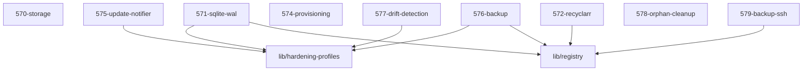

# LLM Wiki: `57-maintenance`

> **Zweck:** Wartung — Provisionierung, Backup, Drift-/Müll-Erkennung, Updates, Speicher-Tiering.

Alles **unterhalb der AUTO-GENERATED-Markierung** stammt aus den NIXMETA-Headern
(`python3 50-core/medinix-meta.py generate-docs`) — **nie** von Hand ändern, sonst
wird `check-docs` rot. Dieser manuelle Teil bleibt erhalten (den Marker-String
nicht wörtlich im Text nennen, sonst schneidet der Generator dort ab).

**Rolle:** Wartungs-/Betriebsdomäne (57x).

**Verantwortung:**
- Storage-Tiering (MergerFS + Verzeichnisstruktur), SQLite-WAL-Tuning
- `574` Provisioning — schreibt Kategorien/Indexer in die *arr-APIs (liest `manifest` und `arr.category`)
- Recyclarr-Sync, Update-Notifier (ntfy), Restic-Backup des A2-State, Drift-Detection, Orphan-Cleanup, SSH-Pull-User

**Nicht verantwortlich für:**
- die Dienste selbst → jeweilige Domäne
- Ingress/Auth → `51-ingress`; Monitoring → `58-observability`

**Source of truth:**
- Provisioning-Vertrag → `manifest` (Dienste) + `57-maintenance/574-provisioning.nix`
- zu schützender Zustand → `lib/registry.nix` (`stateDir`)
- Ignorier-Listen (z. B. Orphan-Cleanup) leben im jeweiligen Modul

**Bekannte Klemmen:**
- `574` ist die einzige Stelle, die *arr-Kategorien gegen die API durchsetzt: eine Änderung an `arr.category` wirkt dort, nicht im *arr-Modul.
- Backup und Drift-Detection arbeiten auf `stateDir`-Pfaden aus der Registry — Änderungen daran sind Betriebseingriffe.

<!-- AUTO-GENERATED, DO NOT EDIT BELOW -->

> ⚙️ **Maschinell erzeugt** aus den NIXMETA-Headern der Module (`python3 50-core/medinix-meta.py generate-docs`).
> **Nicht von Hand aendern** — handgepflegt ist nur der Teil **ueber** der Markierung; die Wahrheit steht in den unten verlinkten `.nix`-Dateien (`docs/CONVENTIONS.md` §1).

## Module Map

| ID | Modul-Datei | Status | Komplexitaet | Ports |
|---|---|---|---|---|
| `570-storage` | [`570-storage.nix`](570-storage.nix) | active | 4/5 | - |
| `571-sqlite-wal` | [`571-sqlite-wal.nix`](571-sqlite-wal.nix) | active | 3/5 | - |
| `572-recyclarr` | [`572-recyclarr.nix`](572-recyclarr.nix) | active | 3/5 | - |
| `574-provisioning` | [`574-provisioning.nix`](574-provisioning.nix) | active | -/5 | - |
| `575-update-notifier` | [`575-update-notifier.nix`](575-update-notifier.nix) | active | 3/5 | - |
| `576-backup` | [`576-backup.nix`](576-backup.nix) | active | -/5 | - |
| `577-drift-detection` | [`577-drift-detection.nix`](577-drift-detection.nix) | active | 3/5 | - |
| `578-orphan-cleanup` | [`578-orphan-cleanup.nix`](578-orphan-cleanup.nix) | active | 3/5 | - |
| `579-backup-ssh` | [`579-backup-ssh.nix`](579-backup-ssh.nix) | active | -/5 | - |

## Interne Abhaengigkeiten (Requires)

Die Module in diesem Ordner benoetigen folgende Bibliotheken/Dateien:

- [`lib/hardening-profiles`](../lib/hardening-profiles.nix)
- [`lib/registry`](../lib/registry.nix)

## Dependency Graph

---
*Maschinell erzeugt durch `python3 50-core/medinix-meta.py generate-docs` aus den NIXMETA-Headern der oben verlinkten `.nix`-Dateien. Handgepflegt ist nur der Teil ueber der AUTO-GENERATED-Markierung.*
