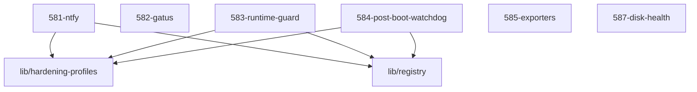

# LLM Wiki: `58-observability`

> **Zweck:** Beobachtbarkeit und Selbstheilung — Benachrichtigungen, Health-Übersicht, Exporters, Wachhunde.

Alles **unterhalb der AUTO-GENERATED-Markierung** stammt aus den NIXMETA-Headern
(`python3 50-core/medinix-meta.py generate-docs`) — **nie** von Hand ändern, sonst
wird `check-docs` rot. Dieser manuelle Teil bleibt erhalten (den Marker-String
nicht wörtlich im Text nennen, sonst schneidet der Generator dort ab).

**Rolle:** Observability-Domäne (58x).

**Verantwortung:**
- `581` ntfy (Notify-Backend), `582` Gatus (Health-Dashboard)
- Exporters (manifest-getrieben), Runtime-Guard, Post-Boot-Watchdog, SMART-Monitoring

**Nicht verantwortlich für:**
- Alarm-Policy und Rufbereitschaft des Betreibers
- Ingress/Auth → `51-ingress`; Backup → `57-maintenance`

**Source of truth:**
- was überwacht wird → `manifest`: Gatus und die Exporters sind **Manifest-Konsumenten**, kein Dienst erscheint dort von selbst
- Endpunkte/Ports → `lib/registry.nix`

**Bekannte Klemmen:**
- Der Runtime-Guard prüft die *laufende* Maschine (nftables/`0.0.0.0`/VPN) und braucht dafür `CAP_NET_ADMIN` (`583`).
- Ein neuer Dienst landet nur dann auf Dashboard und Exporters, wenn sein Manifest-Eintrag stimmt — sonst bleibt die Lücke unsichtbar.

<!-- AUTO-GENERATED, DO NOT EDIT BELOW -->

> ⚙️ **Maschinell erzeugt** aus den NIXMETA-Headern der Module (`python3 50-core/medinix-meta.py generate-docs`).
> **Nicht von Hand aendern** — handgepflegt ist nur der Teil **ueber** der Markierung; die Wahrheit steht in den unten verlinkten `.nix`-Dateien (`docs/CONVENTIONS.md` §1).

## Module Map

| ID | Modul-Datei | Status | Komplexitaet | Ports |
|---|---|---|---|---|
| `581-ntfy` | [`581-ntfy.nix`](581-ntfy.nix) | active | 3/5 | - |
| `582-gatus` | [`582-gatus.nix`](582-gatus.nix) | active | -/5 | - |
| `583-runtime-guard` | [`583-runtime-guard.nix`](583-runtime-guard.nix) | active | 3/5 | - |
| `584-post-boot-watchdog` | [`584-post-boot-watchdog.nix`](584-post-boot-watchdog.nix) | active | 2/5 | - |
| `585-exporters` | [`585-exporters.nix`](585-exporters.nix) | active | -/5 | - |
| `587-disk-health` | [`587-disk-health.nix`](587-disk-health.nix) | active | 2/5 | - |

## Interne Abhaengigkeiten (Requires)

Die Module in diesem Ordner benoetigen folgende Bibliotheken/Dateien:

- [`lib/hardening-profiles`](../lib/hardening-profiles.nix)
- [`lib/registry`](../lib/registry.nix)

## Dependency Graph

---
*Maschinell erzeugt durch `python3 50-core/medinix-meta.py generate-docs` aus den NIXMETA-Headern der oben verlinkten `.nix`-Dateien. Handgepflegt ist nur der Teil ueber der AUTO-GENERATED-Markierung.*
