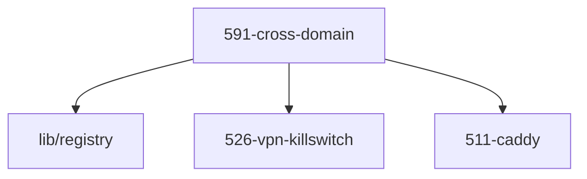

# LLM Wiki: `59-guardrails`

> **Zweck:** Domänenübergreifende Invarianten — die Assertions, die kein einzelnes Modul allein verantworten kann.

Alles **unterhalb der AUTO-GENERATED-Markierung** stammt aus den NIXMETA-Headern
(`python3 50-core/medinix-meta.py generate-docs`) — **nie** von Hand ändern, sonst
wird `check-docs` rot. Dieser manuelle Teil bleibt erhalten (den Marker-String
nicht wörtlich im Text nennen, sonst schneidet der Generator dort ab).

**Rolle:** Guardrail-Domäne (59x) — hier steht nur, was mehrere Domänen zugleich betrifft.

**Verantwortung:**
- `591` Cross-Domain-Assertions: fail-closed, der Build bricht statt zu warnen (ADR-0003 §3)

**Nicht verantwortlich für:**
- Assertions zu einem einzelnen Dienst — die stehen **inline** in ihrem Modul

**Source of truth:**
- jede Regel steht bei ihrem Gegenstand; dieser Ordner sammelt nur die domänenübergreifenden

**Bekannte Klemmen:**
- ADR-5043 fordert in Abschnitt 1 ein zentrales Register (`59-guardrails/590-registry.nix` mit `invariants`/`errors`). **Die Datei existiert nicht**, und ADR-0003 §3 verbietet genau das („no central assertion registries"). Der Widerspruch ist als Governance-Entscheidung offen (Review 2026-10-17, Finding 25); bis dahin gilt der Code: inline, ohne Codes, mit lesbarem Was/Warum/Wie.

<!-- AUTO-GENERATED, DO NOT EDIT BELOW -->

> ⚙️ **Maschinell erzeugt** aus den NIXMETA-Headern der Module (`python3 50-core/medinix-meta.py generate-docs`).
> **Nicht von Hand aendern** — handgepflegt ist nur der Teil **ueber** der Markierung; die Wahrheit steht in den unten verlinkten `.nix`-Dateien (`docs/CONVENTIONS.md` §1).

## Module Map

| ID | Modul-Datei | Status | Komplexitaet | Ports |
|---|---|---|---|---|
| `591-cross-domain` | [`591-cross-domain.nix`](591-cross-domain.nix) | active | -/5 | - |

## Interne Abhaengigkeiten (Requires)

Die Module in diesem Ordner benoetigen folgende Bibliotheken/Dateien:

- `511-caddy`
- `526-vpn-killswitch`
- [`lib/registry`](../lib/registry.nix)

## Dependency Graph

---
*Maschinell erzeugt durch `python3 50-core/medinix-meta.py generate-docs` aus den NIXMETA-Headern der oben verlinkten `.nix`-Dateien. Handgepflegt ist nur der Teil ueber der AUTO-GENERATED-Markierung.*
